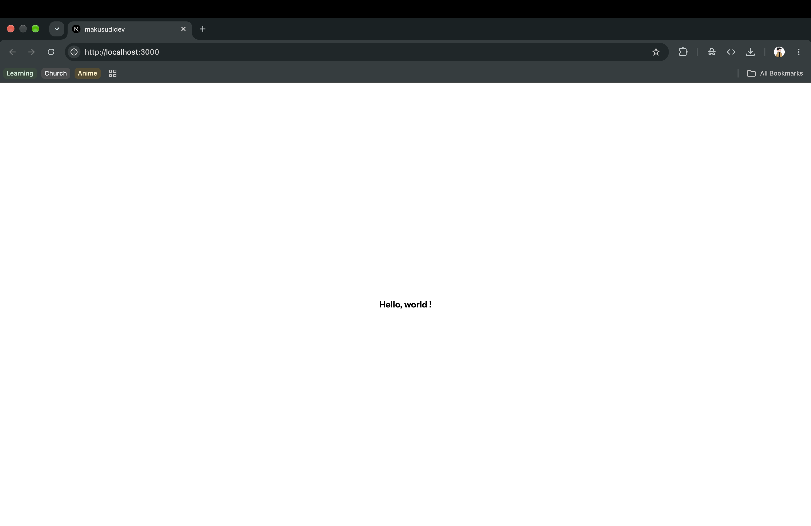

<p align="center">
  
</p>

#### **OVERVIEW**

---

Portfolio website presenting projects, skills and achievements across four pages: Home, About, Projects and Contact. The codebase prioritizes long-term maintainability, with semantic and accessible markup, strict typing, validated configuration and automated quality checks on every commit. Significant architectural decisions are documented alongside the code.

#### **STACK**

---

The project runs on the Next.js App Router, with React for the interface and TypeScript throughout. Styling uses Tailwind CSS, with utility classes kept close to the markup they style. The versions listed are the major releases in use.

> - [x] Next.js 16 (App Router)
> - [x] React 19
> - [x] TypeScript 5
> - [x] Tailwind CSS 4

#### **REQUIREMENTS**

---

The Node.js version is pinned in `.nvmrc` and picked up automatically by version managers such as nvm. Dependencies install with any of the package managers below, although npm matches the lock file used in CI.

> - [x] Node.js 24
> - [x] npm 10 or later, pnpm or Yarn

#### **GETTING STARTED**

---

Clone the repository, install the dependencies, create the local environment file and start the development server. The environment file works out of the box with its default values, so no further configuration is needed.

> ```bash
> git clone https://github.com/makusudijoshua/makcood.git
> cd makcood
> ```
>
> ```bash
> # npm
> npm ci
> cp .env.example .env.local
> npm run dev
> ```
>
> ```bash
> # pnpm
> pnpm install
> cp .env.example .env.local
> pnpm dev
> ```
>
> ```bash
> # Yarn
> yarn install
> cp .env.example .env.local
> yarn dev
> ```

> [!NOTE]
> Exact dependency versions are locked for npm in `package-lock.json`, which CI also uses. pnpm and Yarn resolve versions independently.

#### **GOOD TO KNOW**

---

The project follows a few conventions that differ from a default Next.js setup. Knowing them up front avoids rejected commits, failed builds and failing CI checks.

> - Staged files are formatted and linted automatically on every commit
> - Environment variables are validated in `config/env.ts`
> - Commit messages follow Conventional Commits
> - `npm run quality:check` runs before every pull request
> - Architecture decisions are recorded in [`docs/decisions`](docs/decisions/)

#### **LICENCE**

---

Released under the [MIT License](LICENSE).
